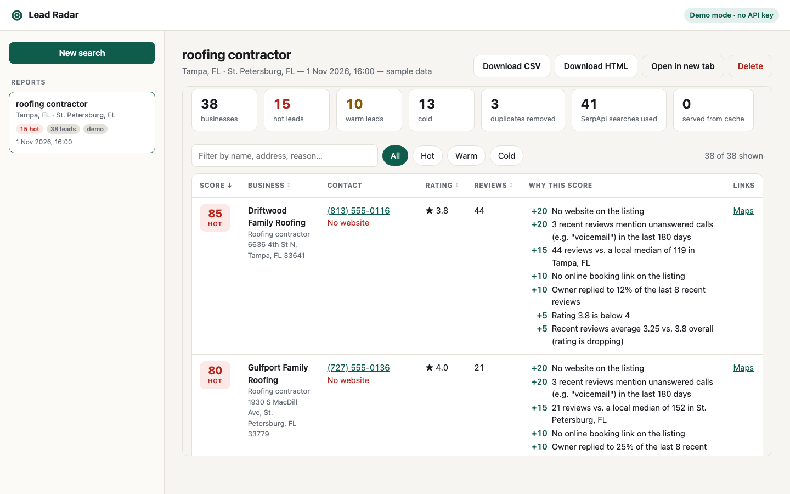

# Lead Radar

Find local home-service businesses on Google Maps and rank the ones most likely to need
automation help: missed-call handling, online booking and review follow-up.

Built on the [SerpApi](https://serpapi.com) Google Maps, Google Maps Reviews and Account APIs.



*The web app showing a report built from the bundled sample data. No real businesses are
shown. The same report as a standalone file: [`examples/demo-report.html`](examples/demo-report.html).*

## The problem

A roofer, plumber or HVAC company loses work every time a call goes to voicemail, and most of
them can't be booked online. If you sell them an answering service, a booking widget or review
automation, the hard part is knowing **who to call first**. Scrolling through Google Maps by
hand doesn't scale, and a raw list of 200 businesses is no better than the map itself.

Lead Radar turns one command into a ranked call list, and every score comes with its reasons:

```
85  Driftwood Family Roofing   (813) 555-0116
    +20 No website on the listing
    +20 3 recent reviews mention unanswered calls (e.g. "voicemail") in the last 180 days
    +15 44 reviews vs. a local median of 119 in Tampa, FL
    +10 No online booking link on the listing
    +10 Owner replied to 12% of the last 8 recent reviews
```

## 60-second quickstart

```bash
git clone <this repo> && cd lead-radar
python3.11 -m venv .venv && source .venv/bin/activate
pip install -e .

cp .env.example .env            # paste your key from https://serpapi.com/manage-api-key
lead-radar web                  # opens http://localhost:8000
```

No key yet? `lead-radar web` still starts, with a **Try the demo** button that runs the whole
pipeline on bundled sample data without spending anything.

## The web app

`lead-radar web` is the everyday way to use Lead Radar:

1. **New search.** Type a niche, add one or more locations, choose how many businesses per
   location and whether to analyse reviews.
2. **Estimate cost.** Shows Google Maps pages, review lookups, what is already cached (free)
   and your remaining SerpApi searches. Nothing is spent yet.
3. **Run.** The button states the exact upper bound you are agreeing to. The server
   re-estimates before starting and refuses a run dearer than what you confirmed, and editing
   the form discards the estimate. A progress view follows the run; **Cancel** stops before
   the next request and keeps everything found so far.
4. **Reports.** Every run is saved and listed in the sidebar. Open one to filter and sort the
   leads, then **Download CSV** or **Download HTML**.

The server listens on `127.0.0.1` only, keeps the API key on the server side, and is a thin
layer over the same `pipeline.estimate()`, `pipeline.run()` and run store that the CLI uses.
Runs started from the CLI appear in the web app's history too.

## Command line

The CLI has everything the web app has, for scripting or a terminal workflow:

```bash
lead-radar account              # plan and searches left (free call)
lead-radar search "roofing contractor" -l "Tampa, FL" --max-results 20
```

## Example

```bash
lead-radar search "hvac contractor" \
  -l "Tampa, FL" -l "St. Petersburg, FL" \
  --max-results 60 \
  --reviews --review-limit 25 \
  --open
```

Before anything is spent you see what the run can cost and what you have left:

```
╭──────────────────────── Credit estimate ─────────────────────────╮
│ Google Maps pages   up to 6    2 location(s) x 3 page(s) of 20   │
│ Review lookups      up to 25   1 search per lead                 │
│ Already cached      0          free, served from disk            │
│ Searches this run   up to 31                                     │
│ Searches left       962        Demo Plan                         │
╰──────────────────────────────────────────────────────────────────╯
Use up to 31 SerpApi searches? [Y/n]:
```

Each run is saved to `out/runs/<run id>/`: a CSV, and an HTML report that is one
self-contained file with a sortable, filterable table, score badges, click-to-call phone
numbers and links to each website and Google Maps listing. The run also shows up in
`lead-radar web`.

| Command | What it does |
| --- | --- |
| `lead-radar web` | Web app: search, browse and download reports |
| `lead-radar search QUERY -l LOCATION...` | Search, score, save CSV + HTML |
| `lead-radar demo` | Same pipeline on bundled sample data, offline |
| `lead-radar account` | Plan, searches left, hourly usage |
| `lead-radar init-config` | Write the default scoring rules to `scoring.yaml` |
| `lead-radar cache info` / `cache clear` | Inspect or empty the response cache |

Useful `search` flags: `--reviews`, `--review-limit N`, `--max-results N` (per location),
`--zoom`, `--config scoring.yaml`, `--yes` (skip confirmation), `--no-cache`, `--out DIR`.

A location is either a place name (`"Tampa, FL"`) or explicit coordinates in SerpApi's `ll`
format (`"@27.9506,-82.4572,12z"`).

## How it uses SerpApi

Field and parameter names below come from the SerpApi documentation, not from guesswork.

### 1. Search: `engine=google_maps`, `type=search`

| Parameter | Value |
| --- | --- |
| `q` | the niche, e.g. `roofing contractor` |
| `location` + `z` | for a place name; SerpApi resolves it to GPS coordinates |
| `ll` | sent instead when the location is already `@lat,lng,zoom`. `ll` can't be combined with `location` or `z`, so neither is sent |
| `start` | `0`, `20`, `40`... |
| `hl` | interface language |

**Pagination.** Lead Radar advances `start` by 20 and stops as soon as any of these is true:

- `--max-results` is reached for that location,
- the page has no `local_results` (SerpApi reports this as a *successful* search with an
  `error` message, so it is treated as "end of results", not as a failure),
- the response has no `serpapi_pagination.next`,
- a page contains nothing new (Google sometimes repeats itself),
- `start` would pass 100. SerpApi recommends that ceiling because results beyond it "might be
  duplicated or irrelevant", so paying for those pages is rarely worth it.

**Dedupe.** Businesses are keyed by `place_id` across pages *and* across locations, so a
contractor that ranks in both Tampa and St. Petersburg is counted once (the first sighting
wins). `data_id` and `data_cid` are fallbacks for a result without a `place_id`.

**Fields read from each `local_results` item:** `title`, `place_id`, `data_id`, `data_cid`,
`type`, `address`, `phone`, `website`, `rating`, `reviews`, `hours`, `operating_hours`,
`gps_coordinates`, `unclaimed_listing`, `service_options`, `extensions`, and the booking links
`reserve_a_table` / `order_online`.

> **About online booking.** The documented booking link fields are `reserve_a_table` and
> `order_online`, which are restaurant-oriented. For home services Lead Radar also matches
> keywords such as "Online appointments" in `service_options` and `extensions`. Both lists are
> configurable (`detection.booking_link_fields`, `detection.booking_keywords`), so adding a
> field takes one line of YAML. "No online booking" therefore means "none visible on the
> Maps listing", which is exactly what a prospect's customers see.

### 2. Reviews (optional): `engine=google_maps_reviews`

With `--reviews`, one request per lead: `data_id` (or `place_id`), `sort_by=newestFirst`,
`num=20`. From each review it reads `rating`, `iso_date`, `extracted_snippet.original`
(falling back to `snippet`, which can be truncated) and whether an owner `response` exists.

This costs one search per lead, so `--review-limit N` restricts it to the N best leads by
listing-only score.

### 3. Credits: the Account API

`https://serpapi.com/account.json` is free and not counted against the quota. Lead Radar calls
it before every run to show `total_searches_left` next to the estimate. It also doubles as a
key check: a wrong key fails here, before any search is attempted.

### 4. Caching

SerpApi serves identical requests from its own cache for free, but that cache expires after
one hour. Lead Radar adds a disk cache with a 7-day default (`--cache-ttl-hours`):

- **Key:** SHA-256 of the sorted request parameters. `api_key` is excluded, so the key never
  touches the disk and the cache can be shared.
- **Layout:** `.lead_radar_cache/<engine>/<hash>.json`, written atomically.
- **Never cached:** searches whose `search_metadata.status` is `Error`.
- **The estimate reads the cache.** The run is replayed against it without calling the API:
  cached pages cost nothing, and if the whole Maps phase is cached the review count is exact
  rather than an upper bound.

In practice: tweak `scoring.yaml` and re-run, and the estimate says *"Everything is cached:
this run costs 0 searches"*. Add `--reviews` to a search you already ran and you pay only for
the reviews.

### 5. Failure handling

| Situation | Behaviour |
| --- | --- |
| Timeout, connection error, HTTP 5xx, `status: Error` | Retried with exponential backoff and jitter (4 attempts) |
| HTTP 401 / 403 | "SerpApi rejected the API key", no retry |
| HTTP 429 "run out of searches" | Stops, **keeps and exports what was collected** |
| HTTP 429 hourly throughput | Same, with a rate-limit message |
| No results | Friendly hint (broader niche, check spelling, lower `--zoom`) |
| Ctrl+C | Scores and exports the partial results, exits with code 130 |

The API key is read from `SERPAPI_API_KEY` (or `.env`) and never printed. `requests` puts the
full URL, key included, into its exception messages, so upstream error text is redacted and
the original exception is not chained into tracebacks. There is a test for that.

## How scoring works

The score is the **sum of the points of every rule that fires, capped at 100**. The reason
list is produced by the same code as the number, so the two can never disagree.

| Rule | Points | Fires when |
| --- | ---: | --- |
| `no_website` | 20 | The listing has no `website` |
| `social_only_website` | 12 | The "website" is a Facebook / Instagram / Yelp-style page |
| `no_online_booking` | 10 | No booking link or booking keyword on the listing |
| `low_review_count` | 15 | Fewer than half the median review count of the same location |
| `unclaimed_listing` | 10 | `unclaimed_listing: true` |
| `low_rating` | 5 | Rating below 4.0 |
| `no_hours_listed` | 5 | No `hours` / `operating_hours` |
| `missed_call_complaints` | 10 each, max 20 | Recent low-rated reviews mention unanswered calls |
| `unanswered_reviews` | 10 | Owner replied to at most 30% of recent reviews |
| `rating_dropping` | 5 | Recent reviews average 0.4+ stars below the overall rating |

The last three need `--reviews`. Without it the maximum score is 65.
Tiers: **hot** is 50 or more, **warm** is 25 or more.

Two details that keep the review signal honest:

- A complaint only counts if the review is rated 3 stars or lower. "They picked up at once,
  the other two went to voicemail" is praise, and is not held against the business.
- Only reviews from the last 180 days count, so a problem fixed two years ago doesn't score.

Everything is configurable. `lead-radar init-config` writes a commented `scoring.yaml`; keep
only the keys you change. Unknown keys are rejected, so a typo fails with
`rules.no_websiet: Extra inputs are not permitted` instead of being silently ignored.

```yaml
tiers: { hot: 40 }
rules:
  no_website: { points: 30 }
  low_rating: { enabled: false, points: 5 }
detection:
  recent_days: 90
  complaint_phrases:
    - 'voice ?mail'
    - 'never (called|phoned)( \w+)? back'
```

Scores are heuristics for prioritising outreach, not facts about a business.

## Project structure

```
src/lead_radar/
  client.py     SerpApi gateway: official `serpapi` client + cache + retries + typed errors
  cache.py      Disk cache keyed by a hash of the request parameters
  pipeline.py   Search params, pagination, dedupe, credit estimate, run orchestration
  models.py     Pydantic models; SerpApi field names kept as validation aliases
  reviews.py    Reviews request params and complaint / response-rate analysis
  scoring.py    One small function per rule; returns score + reasons
  config.py     Scoring config schema; default_scoring.yaml is the editable copy
  export.py     CSV and self-contained HTML report (templates/report.html.j2)
  store.py      Saved runs (out/runs/<id>/), shared by the CLI and the web app
  cli.py        Typer + Rich CLI
  web/          FastAPI app (app.py, jobs.py) + plain HTML/CSS/JS front end (static/)
  demo.py       Offline transport that replays JSON fixtures (demo_data/)
  errors.py     Error types mapped from SerpApi's HTTP status codes
tests/          178 tests, all offline
examples/       Sample CSV and HTML report, generated from the fixtures
scripts/        build_demo_fixtures.py regenerates demo_data/
```

Everything above `client.py` depends only on a two-method `Transport` protocol (`search`,
`account`). That seam is what lets the tests, the demo command and the web app's demo mode
run the real pipeline without a network connection.

The front end has no build step: `index.html`, `styles.css` and `app.js` are served as-is, and
all logic stays in Python. The browser only ever sees run summaries and rendered reports.

## Development

```bash
pip install -e ".[dev]"
pytest          # 178 tests, about 3 seconds, no network
ruff check . && ruff format --check .
mypy            # strict
```

**About the fixtures.** The JSON files in `src/lead_radar/demo_data/` and `tests/fixtures/`
are synthetic: fictional businesses, `555-01xx` phone numbers and `.example` websites, laid
out in the response format documented by SerpApi. They are generated by
`scripts/build_demo_fixtures.py` with a fixed seed. Real responses are deliberately not
committed, because they contain real businesses' contact details.

The tests cover pagination (stop conditions, `start` values), dedupe across pages and
locations, every scoring rule and its thresholds, config validation, CSV/HTML export
(including formula-injection and HTML-escaping of hostile business names), the credit
estimate, retries, error mapping, key redaction, partial results on Ctrl+C or exhausted
credits, cancellation, the CLI, the run store (including path traversal in run ids) and the
web API end to end: estimate, cost confirmation, background runs, cancel, one run at a time,
viewing, downloading and deleting reports. One test fails if
`examples/` drifts from what the code generates.

## License

MIT
